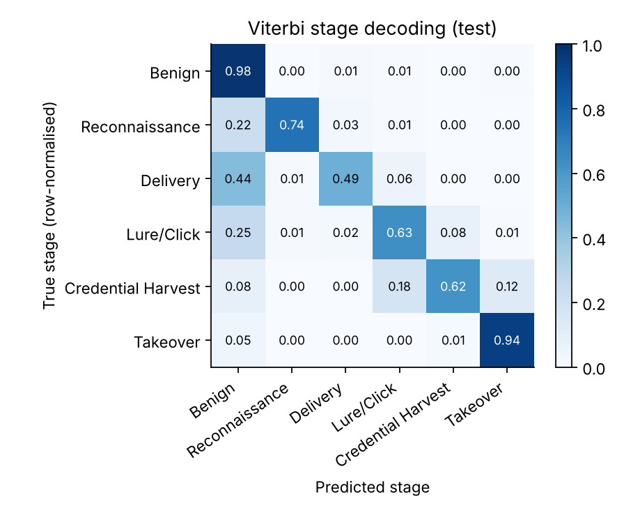
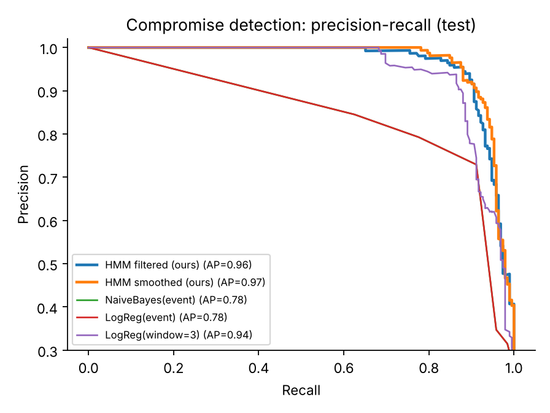
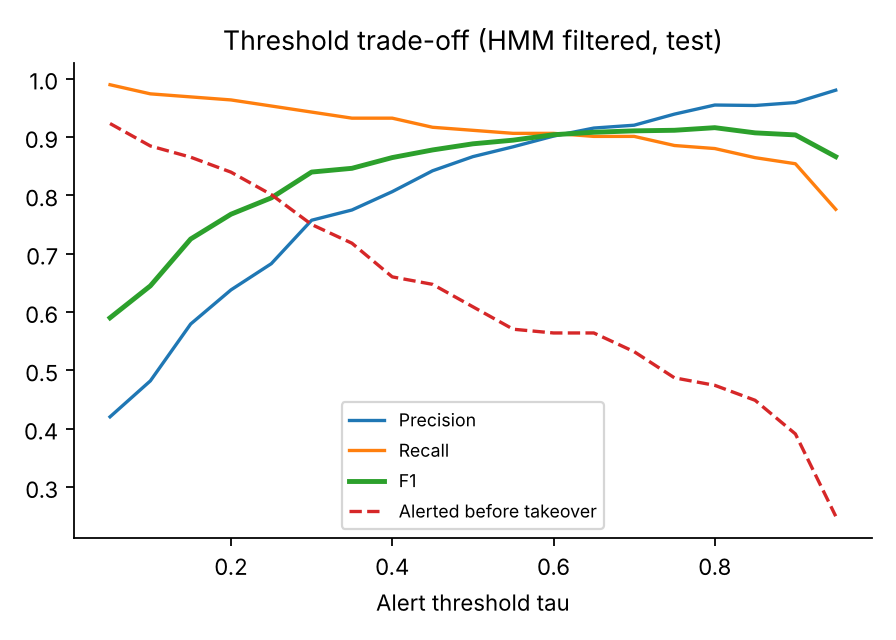
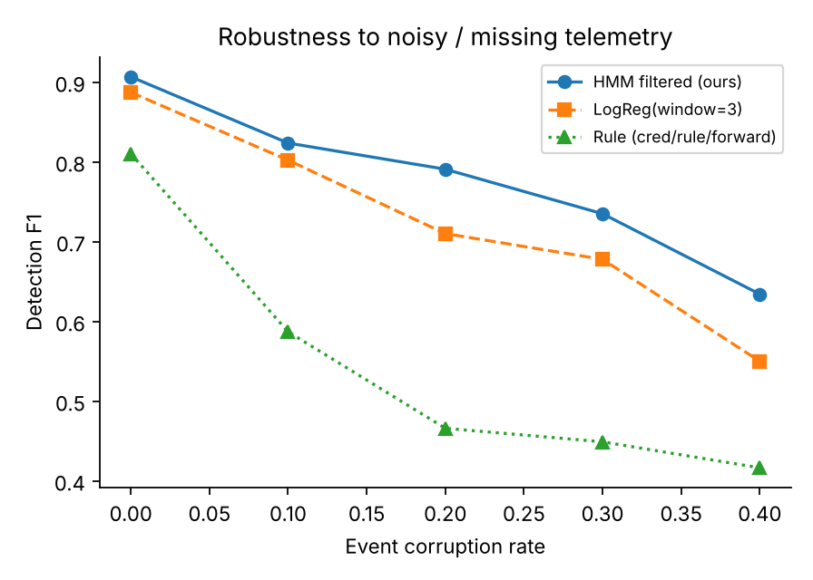

# Intelligent Phishing Campaign Behaviour Detection Using Sequential Models

**Project 17 · Chain factor graph, sum-product and Viterbi · Educational prototype**

## Abstract
A phishing campaign passes through hidden stages (reconnaissance, delivery, victim engagement, credential harvest, takeover), but defenders only see noisy events. We model the stages as a hidden chain, implement **sum-product** (forward-backward) and **Viterbi** from scratch, and use them to infer stage probabilities, decode the most likely stage path and raise early alerts. Real CEAS-08 emails seed the event sequences; the stage labels and all non-email events are synthetic and disclosed as such. On a chronological test split the HMM decodes stages with 91.1% accuracy (macro-F1 0.775) versus 80.7% (0.464) for single-event baselines and 84.4% (0.636) for a 3-event logistic-regression window. For compromise detection it reaches F1 0.907, which is not statistically distinguishable from the window baseline (0.887). Our implementation matches `hmmlearn` on 100% of Viterbi decisions.

## 1. Problem and objectives
Infer hidden campaign stages from chronological events; construct sequences, define a chain factor graph, implement sum-product, apply Viterbi, and evaluate detection (precision, recall, F1) and stage decoding accuracy. The deliverable is an investigation dashboard with stage probabilities and alerts.

## 2. Data and disclosure
* **Real data (CEAS-08):** 39,154 labelled emails (21,842 phishing, 17,312 benign) with sender, date, subject, body and a URL flag. 15 dates were unparseable and some headers are corrupt (years 1980 to 2100). 38,631 emails (98.7%) fall in 4–10 Aug 2008, so we use that window and drop duplicates.
* **Real features:** timestamp, sender domain, URL presence, urgency/credential keywords (verify, password, account, bank, ...). These form four email event categories. Phishing and benign mixes differ only moderately (e.g., URL without keywords: 58% vs 43%), so email content alone is a weak signal.
* **Synthetic data (disclosed):** no public dataset contains campaign stages. The **stage labels and all non-email events** (domain probe, link click, landing page, credential submitted, new-IP login, mailbox rule, bulk forward) come from a documented generator (`src/config.py`, `src/generate_data.py`). Results therefore measure recovery of the generator's structure, which favours a chain model.

## 3. Sequence construction and splitting
3,000 real emails per class are sampled with a fixed seed and sorted by time. Each email **seeds one episode** of 8–16 events: a hidden stage path is drawn from a documented Markov chain (phishing seeds start at Reconnaissance or Delivery and may progress, skip stages or fizzle; benign seeds stay Benign), events are emitted from stage-specific distributions with heavy overlap (`normal_activity` occurs in every stage; clicks and new-IP logins also occur in benign activity), and the real email event is placed at its real timestamp. Totals: 6,000 episodes, 72,013 events.

**Chronological split** by seed-email time: first 70% train (4,200 episodes, 4–7 Aug), next 15% validation (900), last 15% test (900, 8–9 Aug). Time order is asserted in the notebook. Compromise rate (reaches Credential Harvest): 22.7% / 19.9% / 21.3%.

## 4. Model: chain factor graph
Hidden stages Z₁…Z_T (K = 6) and observed events X₁…X_T (M = 12):

p(z, x) = φ₀(z₁) · ∏ₜ φₑ(zₜ, xₜ) · ∏ₜ₌₂ ψ(zₜ₋₁, zₜ)

with prior factor φ₀ (vector π), pairwise transition factor ψ (matrix A) and unary emission factor φₑ (matrix B).

* **Sum-product** passes scaled forward and backward messages along the chain and returns the **filtered** posterior P(Zₜ | X₁:ₜ) (online, used for alerts), the **smoothed** posterior P(Zₜ | X₁:T) (offline, used for investigation) and the log-likelihood.
* **Viterbi** (max-product in log space) returns the single most likely stage path.
* **Estimation:** supervised maximum likelihood by counting with Laplace smoothing, **on the training split only**.

## 5. Evaluation protocol
* **Stage decoding:** per-step accuracy, macro-F1, per-stage P/R/F1, confusion matrix (test: 10,843 steps).
* **Detection:** a campaign is positive if its true path reaches Credential Harvest. An alert fires at the first step where P(Harvest or Takeover | events so far) > τ. τ is tuned on the validation split (maximum F1) and then frozen. We also report the share of takeover campaigns alerted before takeover and median lead time.
* **Reference and baselines:** `hmmlearn` CategoricalHMM loaded with the same parameters; per-event Naive Bayes; logistic regression on the current event and on a 3-event window; a SOC-style rule (alert on credential submission, mailbox rule or bulk forward).
* **Correctness tests:** brute-force enumeration on tiny models and comparison with `hmmlearn` (`tests/test_hmm.py`).

## 6. Results (test split, seed 42)

**Table 1. Stage decoding**

| Method | Accuracy | Macro-F1 |
|---|---|---|
| HMM Viterbi (ours) | 0.911 | 0.775 |
| HMM sum-product argmax (ours) | 0.913 | 0.786 |
| Logistic regression, 3-event window | 0.844 | 0.636 |
| Naive Bayes / logistic regression, single event | 0.807 | 0.464 |

Per-stage F1 (Viterbi vs 3-event logistic regression): Benign 0.96 vs 0.91, Reconnaissance 0.83 vs 0.80, **Delivery 0.60 vs 0.33, Lure/Click 0.65 vs 0.41, Credential Harvest 0.69 vs 0.54**, Takeover 0.92 vs 0.83.

**Table 2. Compromise detection (campaign level)**

| Method | Precision | Recall | F1 | τ | Avg. precision |
|---|---|---|---|---|---|
| HMM filtered alert (ours) | 0.959 | 0.859 | 0.907 | 0.878 | 0.962 |
| Logistic regression, 3-event window | 0.942 | 0.839 | 0.887 | 0.829 | 0.943 |
| Rule (credential / mailbox rule / forward) | 0.729 | 0.911 | 0.810 | – | 0.683 |
| Naive Bayes, single event | 0.729 | 0.911 | 0.810 | 0.419 | 0.775 |
| Logistic regression, single event | 0.793 | 0.776 | 0.784 | 0.786 | 0.775 |

HMM confusion counts at τ = 0.878: 165 TP, 7 FP, 27 FN, 701 TN. Validation F1 was 0.900, so the tuned threshold transfers. A paired bootstrap over test campaigns gives F1 95% CIs of [0.872, 0.937] for the HMM and [0.850, 0.920] for the window model; the difference (+0.020) has CI [−0.004, +0.043], so **the detection advantage over the window baseline is not statistically established**, while the stage-decoding advantage is large.

**Table 3. Reference-implementation check.** Our Viterbi path equals the `hmmlearn` path on **100%** of test steps; max |posterior difference| = 5.1e-15; max |log-likelihood difference| = 2.1e-14; identical accuracy (0.911) and macro-F1 (0.775).

**Table 4. Threshold trade-off and lead time (HMM filtered alert)**

| τ | Precision | Recall | F1 | Takeovers alerted before they occur | Median lead (min) |
|---|---|---|---|---|---|
| 0.20 | 0.638 | 0.964 | 0.768 | 84% | 96 |
| 0.50 | 0.866 | 0.911 | 0.888 | 61% | 82 |
| 0.878 (val-tuned) | 0.959 | 0.859 | 0.907 | 42% | 80 |

The F1-optimal threshold is conservative: alerts often arrive at or after credential submission. A lower τ buys earlier warning at the cost of precision; the dashboard slider exposes this trade-off.

**Table 5. Robustness (detection F1; stage accuracy in brackets for HMM / 3-event LR)**

| Event corruption | HMM | 3-event LR | Rule |
|---|---|---|---|
| 0% | 0.907 (0.911 / 0.844) | 0.887 | 0.810 |
| 10% | 0.824 (0.887 / 0.814) | 0.802 | 0.587 |
| 20% | 0.791 (0.849 / 0.779) | 0.710 | 0.466 |
| 30% | 0.735 (0.818 / 0.746) | 0.678 | 0.449 |
| 40% | 0.634 (0.782 / 0.706) | 0.550 | 0.416 |

**Unseen stage skipping** (test set regenerated with a much higher skip probability, models and τ unchanged): detection F1 0.899 (HMM) vs 0.901 (window LR); stage accuracy 0.918 vs 0.837.

## 7. Interpretation
1. **Sequence context matters most for the ambiguous middle stages.** `normal_activity` appears in every stage and clicks or logins also occur in benign activity, so single events cannot separate Delivery, Lure/Click and Credential Harvest. The chain's transition structure resolves them (F1 +0.15 to +0.26 over the window model).
2. **Detection gains are modest.** A short-window classifier is a strong detector on this simple generator; the HMM's edge is within bootstrap uncertainty. Its clearer advantages are better stage decoding, a consistent lead when telemetry is corrupted, and probabilistic outputs that support an interpretable alert threshold.
3. **Where it fails:** Delivery and Lure/Click are mostly confused with neighbouring stages when telemetry is missing; unseen stage skipping removes the detection edge.
4. **Operational reading:** alerts should be tuned for lead time, not only F1.

## 8. Limitations and ethics
Stage labels and non-email events are synthetic and generated from a chain, which favours a chain model; absolute numbers are not real-world performance. One week of 2008 email, simple keyword/URL features, discrete events, one random seed. Real attackers adapt and real telemetry is noisier. **This is an educational prototype, not a production security system.**

## 9. Reproducibility
Fixed seed 42; `python -m src.pipeline --raw data/raw/CEAS_08.csv` regenerates all data, parameters and metrics in about 15 seconds; `python -m pytest tests` runs correctness tests; the executed notebook `notebooks/phishing_sequence_model.ipynb` walks through the full workflow; `streamlit run app/streamlit_app.py` starts the dashboard.
